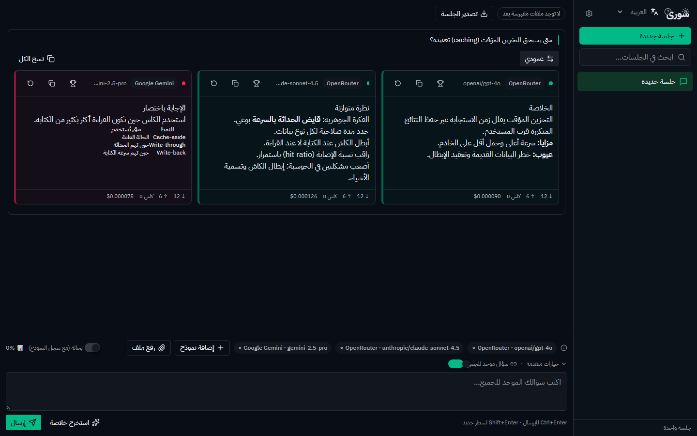
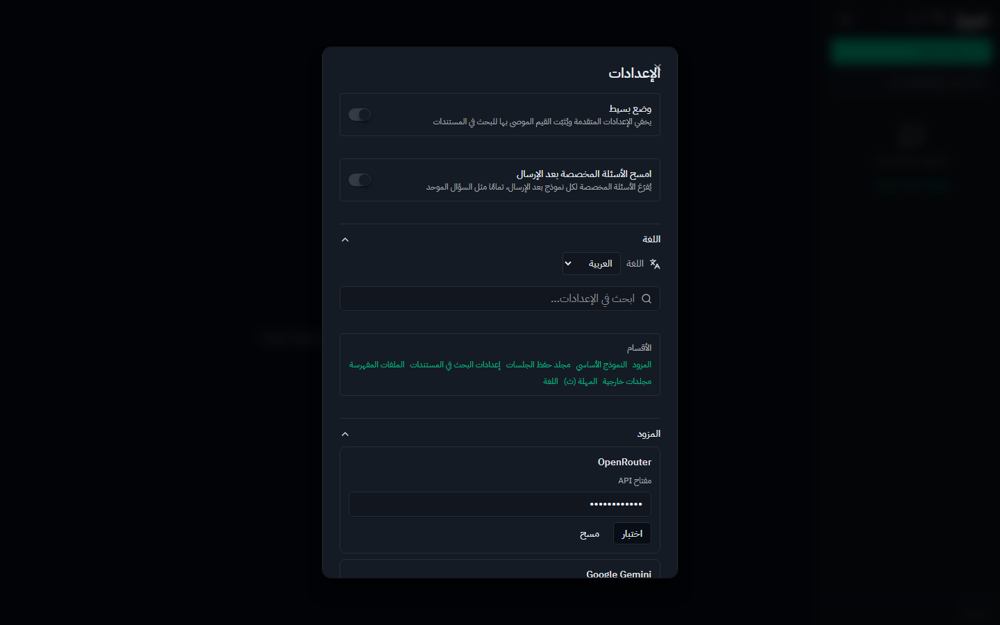
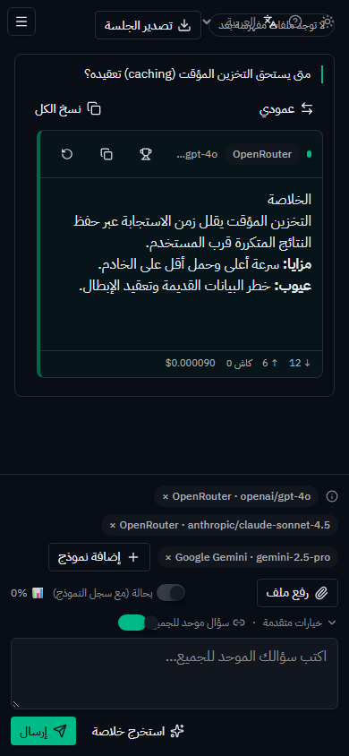
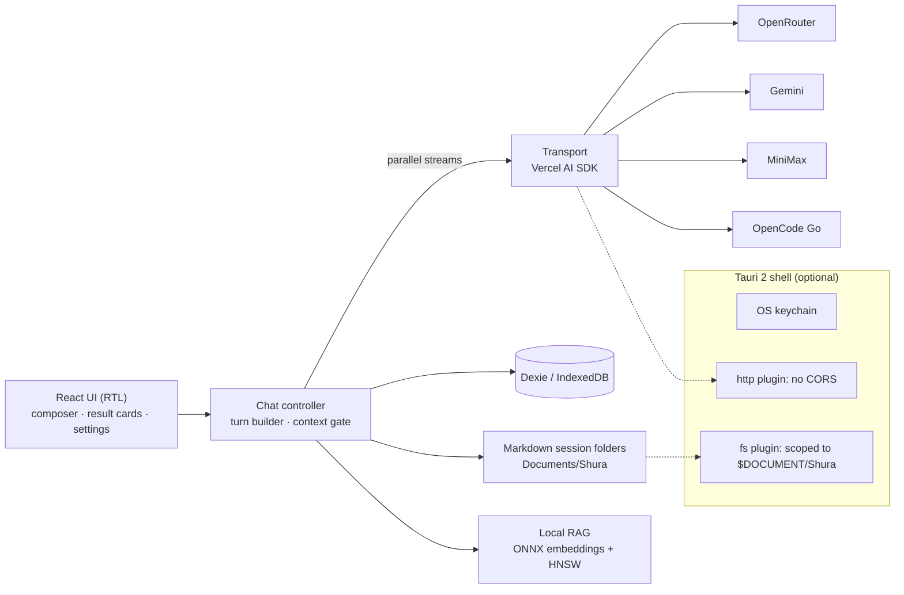

<div dir="rtl">

<div align="center">

# شورى · Shura

[English](README.md) · **العربية**

**اسأل سؤالًا واحدًا، واسمع من نماذج كثيرة — جنبًا إلى جنب، وهي تفكّر.**

تطبيق دردشة عربي (RTL) يعمل محليًا أولًا، يرسل سؤالًا واحدًا إلى عدة مزودي ذكاء اصطناعي **بالتوازي**،
ويبثّ كل إجابة في بطاقتها المستقلة لتقارن بينها. لا باك-إند ولا وسيط: مفاتيحك لا تذهب إلا إلى المزود
صاحبها.

[](https://github.com/ahmadmhmdsy/shura/actions/workflows/ci.yml)




<sub>سؤال واحد وثلاثة نماذج (GPT-4o وClaude Sonnet 4.5 عبر OpenRouter، وGemini 2.5 Pro مباشرة) تُبثّ بالتوازي. اللقطة مأخوذة بالمزوّد الوهمي داخل الصفحة من حزمة اختبارات E2E، فلم تُستخدم أي مفاتيح حقيقية.</sub>

</div>

## أبرز المزايا

| | |
|---|---|
| ⚡ **إرسال متوازٍ** | سؤال موحّد لكل النماذج، أو سؤال مخصص لكل نموذج (الموحّد + المخصص يُدمجان بفاصل، والمخصص وحده يعمل أيضًا). |
| 📡 **بث مباشر** | كل مزود يبث في بطاقته، مع التوكنز وإصابات الكاش والتكلفة لكل إجابة. بدّل بين التخطيط العمودي والأفقي، ويُحفظ اختيارك. |
| 🧠 **الخلاصة** | زر «استخرج خلاصة» يرسل آخر تمرّة إلى النموذج الأساسي للجلسة ويعيد إجابة واحدة مركّبة. |
| 🗂️ **بسياق أو بدونه** | الجلسات تحمل الأدوار السابقة افتراضيًا، مقصوصة إلى 80% من نافذة سياق النموذج المستهدف. ويمكن التحول إلى مقارنة بلا سياق (stateless) لكل جلسة. مؤشر السياق يعرض الاستهلاك، ويعرض «؟» بدل نسبة مختلَقة حين يكون الحد مجهولًا. |
| 📚 **RAG محلي** | ارفع ملفاتك وفهرسها على الجهاز نفسه (تضمينات onnxruntime-web + hnswlib-wasm). لا شيء يغادر جهازك. |
| 💾 **حفظ مزدوج** | IndexedDB (Dexie) للاستعلام السريع، ومجلدات جلسات Markdown مقروءة على القرص يمكنها إعادة بناء القاعدة إن فُقدت. |
| 🔐 **مفاتيحك لك** | سطح المكتب: خزنة نظام التشغيل. الويب: مشفّرة بـ AES-GCM في IndexedDB. لا خادم، لا حسابات، لا تتبّع. |
| 🌍 **مبني للعربية** | واجهة RTL أولًا، وتقدير توكنز واعٍ بالعربية، وطبقة ترجمة صارمة (جموع CLDR وتطابق مفاتيح مفروض). إضافة لغة = ملف موارد واحد. |

**المزودون:** OpenRouter · Google Gemini · MiniMax (intl) · OpenCode Go

<table>
<tr>
<td width="62%"></td>
<td width="38%"></td>
</tr>
<tr>
<td align="center"><sub>الإعدادات: بطاقة لكل مزود مع اختبار حيّ للمفتاح</sub></td>
<td align="center"><sub>متجاوب حتى عرض 390px، بلا تمرير أفقي</sub></td>
</tr>
</table>

## البنية



- **لا باك-إند.** المتصفح أو نافذة Tauri يتصلان بالمزودين مباشرة.
- **غلاف Tauri 2** يضيف نقلًا بلا CORS، وكتابة ملفات حقيقية تحت `Documents\Shura`، وتخزين المفاتيح في خزنة النظام. الصلاحيات محصورة بقائمة سماح في `src-tauri/capabilities/default.json`.
- **قرارات التصميم** موثّقة كسجلات ADR في [`docs/adr`](docs/adr): حفظ الجلسات، وهوية العمليات واسترجاعها، وهوية التضمينات، وCSP سطح المكتب، وفرض الترجمة.

## بوابات الجودة

كل رقم هنا يولّده `pnpm docs:numbers`، لا يُكتب باليد.

| البوابة | النتيجة |
|---|---|
| اختبارات الوحدة والتكامل (vitest) | **<!--G:counts.testsPassed-->1168<!--/G-->/<!--G:counts.tests-->1171<!--/G-->** عبر <!--G:counts.files-->109<!--/G--> ملفًا، بلا شبكة حقيقية ولا مفاتيح حقيقية |
| التغطية | <!--G:cov.statements-->88.63<!--/G-->% statements · <!--G:cov.branches-->82.35<!--/G-->% branches · <!--G:cov.functions-->86.29<!--/G-->% functions · <!--G:cov.lines-->92.49<!--/G-->% lines |
| E2E في المتصفح (Playwright، بناء الإنتاج) | **24/24**، تشمل تدقيق axe، وفحص تخطيط 390px، وحارس «لا طلب يغادر الصفحة» |
| Rust (`cargo fmt` / `check` / `test`) | PASS، 11 اختبارًا |
| ميزانية الحزمة | الحزمة الأساسية <!--G:bundle.entry.kb-->1,112.92<!--/G--> kB مقابل ميزانية 1.2 MB |
| الترجمة ورموز التصميم | اختبارات تطابق اللغات + قواعد lint ترفض الألوان المكتوبة يدويًا |

يشغّل CI ([`.github/workflows/ci.yml`](.github/workflows/ci.yml)) فحص الأنواع وlint والتغطية والبناء وميزانية الحزمة والتدقيق وE2E المتصفح عند كل push، دون أي مفاتيح مزودين، لأن كل مزود محاكى داخل الصفحة.

## البدء السريع

```bash
pnpm install
pnpm dev
```

افتح العنوان المحلي، ثم **الإعدادات**، والصق مفتاحًا لأي مزود واضغط الاختبار الحيّ، ثم ابدأ جلسة وأضف النماذج. يتطلب **Node 24+** و**pnpm 11+**.

## المتطلبات

- **Node 24+** (طُوِّر واختُبر على 24.18.0؛ `.nvmrc` يثبّت `24` و`engines` يشترط `>=22.12.0` — أرضية Vite 8).
- **pnpm 11+** (طُوِّر واختُبر على 11.25.0؛ `devEngines` يشترط `^11.7.0` و`engines` يشترط `>=11.0.0`).
- **اختياري — غلاف سطح المكتب (Tauri 2):** Rust (اختُبر على rustc 1.98.0) + WebView2 (متوفر افتراضيًا في ويندوز 10/11). على هذا الجهاز تحديدًا انظر ملاحظة بيئة الرابط أدناه ووثّقها في [`docs/environment.md`](docs/environment.md).

## التشغيل (وضع الويب)

```bash
pnpm install
pnpm dev
```

ثم افتح العنوان المحلي الذي يطبعه Vite، وأدخل مفاتيح المزودين من **شاشة الإعدادات** داخل التطبيق (زر الإعدادات في الشريط الجانبي): لكل مزود بطاقة مفتاح مع **اختبار حيّ** للمفتاح وزر مسح؛ أما اختيار النموذج الأساسي ومهلة النداء فقسمان مستقلان في شاشة الإعدادات، ومسار الحفظ ثابت للقراءة فقط.

أوامر التحقق (بوابة الإصدار الكاملة):

```bash
pnpm install --frozen-lockfile
pnpm check:all      # typecheck + lint + تغطية + بناء + ميزانية الحزمة + بوابة التدقيق
pnpm build && pnpm test:e2e:browser   # متصفح حقيقي على بناء الإنتاج (مشروع browser)
# ملاحظة: `pnpm test:e2e` بلا `--project` يجمع مشروع tauri أيضًا ويفشل بلا نافذة سطح مكتب حيّة؛
# لتشغيله: `pnpm tauri:dev:e2e` ثم `pnpm test:e2e:tauri` (T6.7).
pnpm tauri:build:windows   # حزمة تثبيت NSIS (بيئة x64 Native Tools — انظر docs/environment.md)
```

آخر سلسلة تحقق معتمدة: **PASS كاملًا** —

| الفحص | النتيجة |
|---|---|
| `pnpm test` (vitest) | **<!--G:counts.testsPassed-->1168<!--/G-->/<!--G:counts.tests-->1171<!--/G--> اختبارًا عبر <!--G:counts.files-->109<!--/G--> ملفًا** — بلا شبكة حقيقية ولا مفتاح (fetch مزيّف محقون إلى طبقة النقل) |
| `pnpm test:coverage` | **PASS** عند عتبات 80/75/80/80 (<!--G:cov.statements-->88.63<!--/G-->% statements · <!--G:cov.branches-->82.35<!--/G-->% branches · <!--G:cov.functions-->86.29<!--/G-->% functions · <!--G:cov.lines-->92.49<!--/G-->% lines) |
| `pnpm typecheck` / `pnpm lint` | PASS (مشروعان: `src` و`tsconfig.node.json`) |
| `pnpm build` + `pnpm check:bundle` | PASS — الحزمة الأساسية <!--G:bundle.entry.kb-->1,112.92<!--/G--> kB (gzip <!--G:bundle.entry.gzip-->313.88<!--/G--> kB) مقابل ميزانية 1,200,000 بايت؛ الهامش <!--G:bundle.headroom.kb-->87.08<!--/G--> kB. البوابة تقيس البايت الخام لا رقم kB المستدير (`scripts/check-bundle.mjs`) |
| `pnpm test:e2e:browser` (Playwright + Chromium) | **24/24** على بناء الإنتاج، بمزوّد **وهمي داخل الصفحة** — لا مفتاح ولا حساب ولا إنفاق |
| `pnpm audit:check` | PASS — كل تنبيه مسجَّل في `docs/security/dependency-advisories.md` بتبرير وتاريخ إعادة مراجعة. (`pnpm audit --json` الخام يعيد exit 1 بـ11 تنبيهًا: 1 حرج، 5 مرتفع، 5 متوسط — لا «صفر ثغرة» كما قيل سابقًا.) |
| `cargo fmt --check` / `cargo check --locked` / `cargo test --locked` | PASS — 11 اختبار Rust |

## سطح المكتب (Tauri 2)

```bash
pnpm tauri dev      # نافذة تطوير
pnpm tauri build    # بناء إنتاج
```

- الغلاف الأصلي يمنح: **نقلًا بلا CORS** (عبر إضافة `http`) و**كتابة ملفات حقيقية** تحت `Documents\Shura` (عبر إضافة `fs`) — بصلاحيات محصورة في `src-tauri/capabilities/default.json`.
- **ملاحظة بيئة الرابط (هذا الجهاز):** rustc يمسك تلقائيًا `link.exe` 14.16 (VC2017) من ضمن مجموعات MSVC المتعددة فيفشل البناء (LNK2001). البناء يتطلب بيئة **vcvars64** (x64 Native Tools) + متغير `CARGO_TARGET_X86_64_PC_WINDOWS_MSVC_LINKER` إلى `link.exe` **14.42** — الخطوات الدقيقة في [`docs/environment.md`](docs/environment.md).
- الحزمة الناجحة على هذا الجهاز: **NSIS** (`shura_0.1.0_x64-setup.exe`). هدف **MSI** يفشل لأن WiX 3 يتطلب .NET Framework 3.5 الغائب هنا.

## مكان الحفظ

- الافتراضي: **`Documents\Shura`** — جلساتك تحت `Documents\Shura\sessions\<مجلد الجلسة>\` ويتضمن كل مجلد:
  - `session.md` — نص الجلسة المقروء بالبشر (قسم تمرّة لكل إرسال)؛
  - `meta.json` — بيانات الجلسة (يعيد الاسترجاع بناءها منه)؛
  - ملف لكل نتيجة نموذج.
- عند فقدان القاعدة أو من جهاز آخر: الاسترجاع تلقائي من المجلدات عند الإقلاع (سطح المكتب) فقط.
- القاعدة المحلية (Dexie) تحفظ الجلسات والرسائل والاستهلاك والإعدادات في IndexedDB المتصفح/الغلاف.

## الأمان

- **المفاتيح محلية فقط:** في نسخة سطح المكتب تُحفظ في خزنة نظام التشغيل، وفي نسخة الويب في سجل IndexedDB مشفّر بـ AES-GCM؛ ولا تغادر جهازك إلا داخل نداء مباشر إلى المزود صاحبها.
- **لا خادم:** لا باك-إند، لا حسابات، لا تتبع — كل الاتصالات من جهازك إلى المزودين مباشرة.
- **صلاحيات محصورة في Tauri:** نطاقات النقل الخمسة (المزودون الأربعة + `huggingface.co` لنموذج التضمين المحلي)، وستة أذونات ملفات بنطاق `$DOCUMENT/Shura/**` فقط — أي مسار آخر يُنكر. (ملاحظة: الرمز الصحيح في Tauri هو `$DOCUMENT` بحرف مفرد، وهو ما تستخدمه `capabilities/default.json`.)
- **مفاتيح سطح المكتب في خزنة نظام التشغيل** عبر أوامر Tauri. **على الويب** تُخزَّن مفاتيح التشفير في IndexedDB؛ وهي تحمي من مواقع أخرى، لكنها **ليست حماية من كود يعمل في أصل الصفحة** — أي شيفرة في الصفحة أو امتداد متصفح أو من يملك الجهاز ويفتح DevTools يستطيع قراءتها. الاستعمال الآمن للمفاتيح الحقيقية هو **نسخة سطح المكتب**؛ النسخة المتصفّحة للتجربة أو لمفاتيح محدودة الصلاحيات. (نموذج التهديد المعتمد: ADR 0001 §5.)
- لا أسرار في المستودع؛ لا `env` مطلوب للتشغيل.

## القيود المعروفة

1. **تقدير الكونتيكست تقريبي:** الحساب **واعٍ بالنص العربي** — ‎2.5 حرف/توكن للعربي و4 للاتيني، والنتيجة موزونة بنسبة الخلط مع تقريب لأعلى (`src/lib/tokens/estimate.ts`، وهو المصدر الوحيد الذي تقرأ منه بوابة السياق ومؤشر الكونتيكست ومقسّم RAG). رقم إرشادي، ليس فاتورة الاستهلاك الدقيقة للمزود.
2. **موديلات Google وMiniMax ثابتة القائمة** (مضمنة في سجل المزودين، قابلة للتحديث يدويًا)؛ وقائمتا OpenRouter وOpenCode Go تُجلبان حيًّا مع كاش (سجل المزودين: `modelsSource`).
3. **CORS يمنع OpenCode Go في وضع الويب:** نتائج فحص المتصفح المباشر (من وثيقة التصميم §4.3، 2026-09-05):

   | المزود | نداء المتصفح المباشر |
   |---|---|
   | OpenRouter | ✅ مفتوح (Access-Control-Allow-Origin: *) |
   | Gemini | ✅ مفتوح |
   | MiniMax | ✅ مفتوح (يُعاد التحقق بنداء فعلي في المرحلة 0) |
   | OpenCode Go | ❌ محجوب (OPTIONS: 404 بلا ترويسات CORS؛ POST: 401 بلا ترويسات) |

   ⇒ استخدام OpenCode Go يتطلب **غلاف سطح المكتب**؛ في وضع الويب يظهر بحالة «يتطلب تطبيق سطح المكتب» بدل فشل صامت.
4. هدف **MSI** في حزم Tauri معطل على هذا الجهاز (غياب .NET 3.5) — استخدم NSIS.
5. **ميزانية الحزمة الأساسية:** <!--G:bundle.entry.kb-->1,112.92<!--/G--> kB مقابل حدّ 1,200,000 بايت (هامش ≈ <!--G:bundle.headroom.kb-->87.08<!--/G--> kB). اتّسع الهامش بعد فصل شيفرة RAG إلى حزم منفصلة، لكن `dist/index.html` يحمّلها مسبقًا عبر `modulepreload` لأن نقاط دخول RAG تُستورد ساكنًا، فالحمولة الفعلية عند الإقلاع <!--G:bundle.eager.kb-->1,331.49<!--/G--> kB — مسجّلة كـLV-09 في المراجعة وتُغلق في T1.3 Step 9؛ والحدّ نفسه لم يُخفَّض ولم يُرفع — انظر `docs/environment.md` §8.2.
6. **اختبار المتصفح يغطّي نسخة الويب (المزوّد وهمي)، لا غلاف سطح المكتب:** الكتابة على القرص فعليًا تحت `$DOCUMENT/Shura` واسترجاعها بعد فقدان القاعدة لم يُختبرا آليًا — تبقى `SKIPPED: متطلب بشري`.

## قائمة الفحص اليدوي — نتائج صادقة (المهمة 15)

السيناريوهات حرفية من الخطة. التقسيم: ما غطته اختبارات آلية (vitest <!--G:counts.testsPassed-->1168<!--/G-->/<!--G:counts.tests-->1171<!--/G--> + Playwright 24/24) مقابل ما يتطلب إنسانًا في بيئة تفاعلية. **لم يُدَّعِ شيء لم يحدث.**

| # | البند | الحكم |
|---|---|---|
| 1 | جلسة جديدة → إضافة 3 نماذج → سؤال موحد ⇒ 3 بطاقات تبث معًا | **مغطى آليًا** (الميكانيزم): `dispatch.spec.ts` «بث متوازٍ لهدفين»، `ChatScreen.spec.tsx` «الإرسال يبث حيًا: السؤال يظهر وبطاقتان بالنص النهائي»، `composerStore.spec.ts` «إضافة هدف». ملاحظة صادقة: الاختبارات استُخدم فيها **هدفان/بطاقتان**؛ السيناريو الحرفي بثلاثة نماذج ومفاتيح حقيقية في واجهة حية — SKIPPED: متطلب بشري (بيئة بلا GUI تفاعلي). |
| 2 | تعطيل الربط → حقل مخصص لنموذج واحد فقط ⇒ البقية تأخذ الموحد | **مغطى آليًا:** `turnBuilder.spec.ts` «موحد + مخصص: المخصص يُلحق بعد الموحد بفاصل»، `composerStore.spec.ts` «تبديل الوضع الموحد يخفي الحقول منطقيًا» و«إضافة هدف ثم إزالته ينظف حقل المخصص». |
| 3 | حقل مخصص بلا موحد ⇒ يعمل المخصص فقط | **مغطى آليًا:** `turnBuilder.spec.ts` «بدون موحد: المخصص فقط لمن كتب، والمقصود يُدرج في dropped»، `chatController.spec.ts` «هدف بلا سؤال يُسقط مع onDropped والبقية تُرسل». |
| 4 | زر ⇄ يبدل عمودي/أفقي ويُحفظ الاختيار | **مغطى آليًا:** `ChatScreen.spec.tsx` «التبديل عمودي/أفقي يُحفظ في Dexie ومخزن الجلسات»، `ResultCard.spec.tsx` «التخطيط يقود الصنف والتسمية: عمودي يعرض أفقي والعكس». |
| 5 | مؤشر الكونتيكست يرتفع مع الجلسة | **مغطى آليًا (منطق الحساب):** `estimate.spec.ts` «مجموع الجلسة يشمل الرسائل النصية فقط» و«النسبة والمستويات: 80% أصفر و95% أحمر». لا اختبار مخصص لمكوّن `ContextMeter` البصري — التحقق البصري الحي: SKIPPED: متطلب بشري (بيئة بلا GUI تفاعلي). |
| 6 | إعادة تحميل الصفحة ⇒ الجلسة موجودة (Dexie) | **مغطى آليًا:** `repos.spec.ts` (إنشاء/سرد/إلحاق)، `ChatScreen.spec.tsx` «الخلاصة تثبت صفها في Dexie عند الاكتمال: إعادة التحميل تعرض النص لا بثًا معلقًا»، `settingsStore.spec.ts` (لقطة الإعدادات تُستعاد). عبر `fake-indexeddb` — إعادة تحميل متصفح حية: SKIPPED: متطلب بشري (بيئة بلا GUI تفاعلي). |
| 7 | داخل Tauri: الملفات تظهر في `Documents\Shura\sessions` | **SKIPPED: متطلب بشري (بيئة بلا GUI تفاعلي)** — يتطلب نافذة Tauri حية وكتابة فعلية تحت Documents. أقرب تغطية آلية (بأحواض اختبار، لا نظام ملفات حقيقي): `ChatScreen.spec.tsx` «أول إرسال يملأ onDiskDir ويكتب الجلسة على القرص»، `writer.spec.ts`، `parser.spec.ts` (استرجاع من `meta.json`). |
| 8 | زر الخلاصة يعيد خلاصة مركبة من آخر تمرّة | **مغطى آليًا (بنموذج مزيّف):** `ChatScreen.spec.tsx` «الخلاصة تثبت صفها في Dexie عند الاكتمال»، «ضغط مزدوج على الخلاصة لا يولد تمريرتي خلاصة»، «إعادة المحاولة تعمل بعد وجود خلاصة: تُعاد من تمريرة المصدر». جودة الخلاصة بمفتاح حقيقي: SKIPPED: متطلب بشري (بيئة بلا GUI تفاعلي). |

## تغطية جديدة من اختبار المتصفح (المهمة 11)

بقيت بنود القائمة أعلاه مغطّاة آليًا في المتصفح نفسه على بناء الإنتاج (بمزوّد وهمي داخلي، بلا مفتاح
وبلا شبكة خارجية)؛ هذه أرقام `e2e/app.spec.ts`:

| البند | السيناريو الآلي |
|---|---|
| 1 (جزئيًا) | «مسودة جلستين لا تتسرّب»: جلستان بموديلين مختلفين، وأول مسودة تظهر في سياقها الثانية لا — ناقل الإرسال نفسه، لكن ببطاقة واحدة بدل ثلاثة (السيناريو الحرفي بثلاثة نماذج لم يُنفَّذ آليًا). |
| 6 | «إجابة متوقّفة جزئيًا وحالتها تنجو من إعادة التحميل» + «جلسة محذوفة لا تعود»: إعادة تحميل حقيقية على البناء الإنتاجي مع تحقق من حالة IndexedDB. |
| جديد | «متابعة stateful ترسل السجل للمزوّد»: جسم الطلب الثاني يجب أن يحمل سؤال المستخدم الأول وردّه. **هذا الاختبار كشف عطلًا حقيقيًا**: كان السؤال يختفي من المحادثة ولا يُرسل كسياق (انظر `docs/environment.md` §10). |
| جديد | «إعادة المحاولة تعيد السؤال المخصص التاريخي لا مسودة المؤلف». |
| جديد | «لا يخرج أي طلب خارجي»: كل طلب لغير `127.0.0.1:4317` يُسجَّل ويُلغى، والاختبار يفرض فراغ السجل. |
| جديد | «واجهة الإعدادات»: مفتاح وهمي، `Escape` يغلق و`Tab` يعيد التركيز، والمفتاح لا يظهر في سجل الإعدادات المحفوظ. |
| جديد | «التخطيط»: تنقّل بلوحة المفاتيح، وعرض 390px بلا تمرير أفقي، وحجب موارد Markdown البعيدة. |
| جديد | «تدقيق axe»: صفر مخالفة من نوعَي `label` و`select-name` (كشف ثلاثة حقول بلا اسم ميسَّر؛ أُصلحت). |

## المراجع

- وثيقة التصميم المعتمدة: `docs/superpowers/specs/2026-09-05-shura-app-design.md`
- خطة MVP: `docs/superpowers/plans/2026-09-05-shura-mvp.md`
- سجل بيئة التنفيذ الفعلية (بما فيها وصفة بناء Rust على هذا الجهاز): `docs/environment.md`
- تقارير تنفيذ المهام 1-15: `.superpowers/sdd/task-*-report.md` (غير متتبعة في Git)

## التوثيق

- [دليل المستخدم](docs/user-guide.md) · [استكشاف الأخطاء](docs/troubleshooting.md) · [ملاحظات البيئة والبناء](docs/environment.md)
- [سجلات قرارات البنية](docs/adr) · [سجل التنبيهات الأمنية](docs/security) · [قائمة فحص الإصدار](docs/release-checklist.md)

## الترخيص

[MIT](LICENSE) © 2026 Ahmad Mahmoud

</div>
