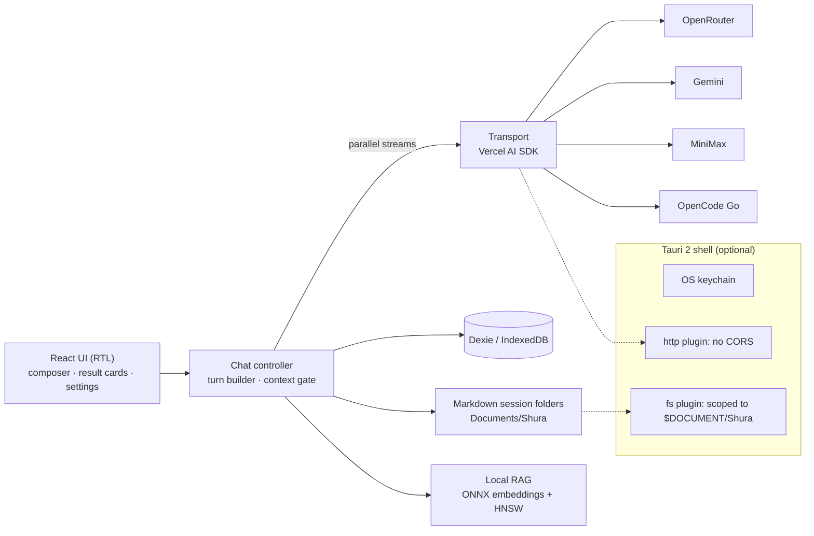

<div align="center">

# شورى · Shura

**English** · [العربية](README.ar.md)

**Ask one question. Hear from many models. Side by side, as they think.**

A local-first Arabic (RTL) chat app that sends a single prompt to several AI providers **in parallel**
and streams every answer into its own card, ready to compare. No backend and no middleman: your
keys go only to the provider they belong to.

[](https://github.com/ahmadmhmdsy/shura/actions/workflows/ci.yml)


<sub>One question, three models (GPT-4o and Claude Sonnet 4.5 via OpenRouter, Gemini 2.5 Pro direct), streamed in parallel. The screenshot uses the in-page mock provider from the E2E suite, so no real keys were involved.</sub>

</div>

## Highlights

| | |
|---|---|
| ⚡ **Parallel dispatch** | One shared question for every model, or a custom question per model (shared + custom are joined; custom alone works too). |
| 📡 **Live streaming** | Each provider streams into its own card, with tokens, cache hits and cost per answer. Toggle vertical or horizontal layout; the choice is saved. |
| 🧠 **Synthesis** | "استخرج خلاصة" (Extract a summary) sends the last round to the session's primary model and returns one combined answer. |
| 🗂️ **Stateful or stateless** | Sessions carry earlier turns by default, trimmed to 80% of the target model's context window. Switch to stateless comparison per session. A context meter shows usage, and shows "?" instead of a made-up percentage when the limit is unknown. |
| 📚 **Local RAG** | Upload files and index them on-device (onnxruntime-web embeddings + hnswlib-wasm). Nothing leaves the machine. |
| 💾 **Dual persistence** | IndexedDB (Dexie) for fast queries, plus human-readable Markdown session folders on disk that can rebuild the database if it is lost. |
| 🔐 **Keys stay yours** | Desktop: OS keychain. Web: AES-GCM encrypted in IndexedDB. No server, no accounts, no telemetry. |
| 🌍 **Built for Arabic** | RTL-first UI, Arabic-aware token estimation, and a strict i18n layer (CLDR plurals, enforced key parity). Adding a language is one resource file. |

**Providers:** OpenRouter · Google Gemini · MiniMax (intl) · OpenCode Go

<table>
<tr>
<td width="62%"></td>
<td width="38%"></td>
</tr>
<tr>
<td align="center"><sub>Settings: one card per provider, with a live key test</sub></td>
<td align="center"><sub>Responsive down to 390px, no horizontal scroll</sub></td>
</tr>
</table>

## Architecture



- **No backend.** The browser or Tauri webview calls the providers directly.
- **Tauri 2 shell** adds CORS-free transport, real file writes under `Documents\Shura`, and keychain storage. Capabilities are allow-listed in `src-tauri/capabilities/default.json`.
- **Design decisions** are recorded as ADRs in [`docs/adr`](docs/adr): session persistence, operation identity and recovery, embedding identity, desktop CSP, and i18n enforcement.

## Quality gates

Every number here is generated by `pnpm docs:numbers`, not typed by hand.

| Gate | Result |
|---|---|
| Unit and integration tests (vitest) | **<!--G:counts.testsPassed-->1168<!--/G-->/<!--G:counts.tests-->1171<!--/G-->** across <!--G:counts.files-->109<!--/G--> files, with no real network and no real keys |
| Coverage | <!--G:cov.statements-->88.63<!--/G-->% statements · <!--G:cov.branches-->82.35<!--/G-->% branches · <!--G:cov.functions-->86.29<!--/G-->% functions · <!--G:cov.lines-->92.49<!--/G-->% lines |
| Browser E2E (Playwright, production build) | **24/24**, including an axe audit, a 390px layout check, and a "no request leaves the page" guard |
| Rust (`cargo fmt` / `check` / `test`) | PASS, 11 tests |
| Bundle budget | <!--G:bundle.entry.kb-->1,112.92<!--/G--> kB entry chunk against a 1.2 MB budget |
| i18n and design tokens | Locale parity tests plus lint rules that reject hard-coded colours |

CI ([`.github/workflows/ci.yml`](.github/workflows/ci.yml)) runs typecheck, lint, coverage, build, bundle budget, audit and browser E2E on every push. It holds no provider credentials, because every provider is mocked inside the page.

## Quick start

```bash
pnpm install
pnpm dev
```

Open the local URL, open **Settings** (الإعدادات), paste a key for any provider and press the live test, then start a session and add models. Requires **Node 24+** and **pnpm 11+**.

Desktop build (Rust + WebView2):

```bash
pnpm tauri dev
pnpm tauri:build:windows
```

Full release gate:

```bash
pnpm check:all
pnpm build && pnpm test:e2e:browser
```

## Documentation

- [User guide](docs/user-guide.md) · [Troubleshooting](docs/troubleshooting.md) · [Environment and build notes](docs/environment.md)
- [Architecture decision records](docs/adr) · [Security advisories register](docs/security) · [Release checklist](docs/release-checklist.md)
- Arabic README with the full manual test results, known limitations and the Windows build recipe: [README.ar.md](README.ar.md)

## License

[MIT](LICENSE) © 2026 Ahmad Mahmoud
